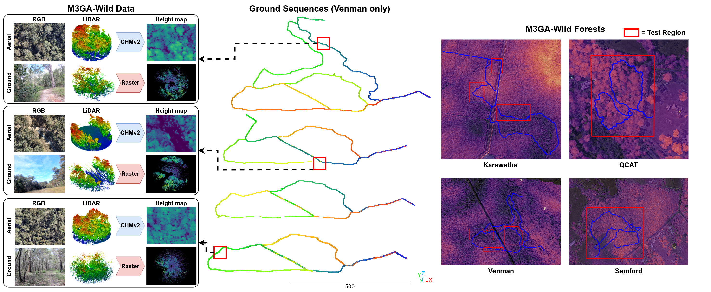

<div align="center">
<h1>M3GA-Wild: A Large-Scale Dataset and Benchmark for Multi-Modal Multi-session Ground-to-Aerial Place Recognition in Forests</h1>

<h2> Accepted at WACV 2027 </h2>

[**Ethan Griffiths**](https://scholar.google.com/citations?user=a6BiSqoAAAAJ&hl=en)<sup>1,2</sup> , [**Maryam Haghighat**](https://www.qut.edu.au/about/our-people/academic-profiles/maryam.haghighat)<sup>1</sup> , [**Simon Denman**](https://www.qut.edu.au/about/our-people/academic-profiles/s.denman)<sup>1</sup> , [**Clinton Fookes**](https://www.qut.edu.au/about/our-people/academic-profiles/c.fookes)<sup>1</sup> , [**Milad Ramezani**](https://scholar.google.com/citations?user=fn-lMpMAAAAJ&hl=en)<sup>2</sup>

<sup>1</sup>Queensland University of Technology&emsp;&emsp;&emsp;<sup>2</sup>CSIRO Robotics
<br>

<a href='https://arxiv.org/abs/2609.23003'></a>
<a href='https://csiro-robotics.github.io/M3GA-Wild'></a>
<a href='https://data.csiro.au/collection/79124'></a>
<a href='https://huggingface.co/EGriffiths-CSIRO/M3GA-Wild'></a>
</div>

This repository contains supporting scripts for downloading, training, and evaluating methods on **M3GA-Wild**, a large-scale dataset and benchmark for multi-modal ground-to-aerial place recognition in forests.




## What's New

- **[2026-12]**: Project page, code, weights, and dataset are all released.
- **[2026-11]**: M3GA-Wild Paper is accepted to WACV 2027. 

## Download Instructions
Our dataset can be downloaded through the [**CSIRO Data Access Portal**](https://data.csiro.au/collection/79124).  Detailed instructions for downloading the dataset and further data collection details can be found in the README file provided on the data access portal page.

1. Download the M3GA-Wild dataset, as per the README instructions from the Data Access Portal.
2. Extract the desired data folders from the tarballs. For our experiments, only the `clouds_voxel_0.80m_rmground`, `images_shrunk`, `heightmaps_shrunk`, and `chmv2_heightmaps_shrunk` folders are needed. To extract all relevant tarballs, run:
```bash
find <m3gawild_download_path> -type f \( -name 'clouds_voxel_0.80m_rmground.tar.zst' -o -name 'images_shrunk.tar' -o -name 'heightmaps_shrunk.tar' -o -name 'chmv2_heightmaps_shrunk.tar' \) -execdir tar -xvf {} \;
```
3. Place or symlink the `data/` folder of the M3GA-Wild download to `data/M3GA-Wild` of this repository. For example:
```bash
ln -s <m3gawild_download_path>/data ./data/M3GA-Wild
```

## Usage

### Reproducing Experiments
Benchmarks are separated into:
- [Visual Place Recognition (VPR)](benchmarking/VPR/README.md)
- [LiDAR Place Recognition (LPR) + Multi-Modal Place Recognition (MMPR)](benchmarking/LPR+MMPR/README.md)
- [Cross-Modal Place Recognition (CMPR)](benchmarking/CMPR/README.md)

Each set of benchmarks has a Pixi environment provided to streamline environment setup. Pre-trained checkpoints used in the M3GA-Wild evaluations can be found on our [HuggingFace page](https://huggingface.co/EGriffiths-CSIRO/M3GA-Wild), categorised by modality and low/high altitude LiDAR. Follow the instructions within each README for where to place checkpoints for each set of experiments. 

### Data Loading and Visualisation
Instructions on how to load each of the data modalities (RGB Image, Heightmap, 3D Submap) can be found in `example_loaders.py`, and a script to visualise the height maps (ground and CHMv2) can be found in `visualise_heightmap.py`

## Acknowledgements
We thank the authors of [WildCross](https://github.com/csiro-robotics/WildCross), NetVLAD, [MixVPR](https://github.com/amaralibey/MixVPR), [SALAD](https://github.com/serizba/salad), [BOQ](https://github.com/amaralibey/Bag-of-Queries), [AnyLoc](https://github.com/AnyLoc/AnyLoc), [LIP-Loc](https://github.com/Shubodh/lidar-image-pretrain-VPR), [DepthAnythingV2](https://github.com/DepthAnything/Depth-Anything-V2), whose implementations form the basis of the training and evaluation code presented in this repository. We also acknowledge the support of
Nearmap in providing high-resolution geo-referenced aerial imagery, and the Queensland Government in providing the airborne LiDAR scans.

## Citation
If you find this repository useful or use M3GA-Wild in your work, please cite the paper using the following:
```bibtex
@inproceedings{GriffithsM3GAWild2027,
  title     = {{M3GA-Wild}: A Large-Scale Dataset and Benchmark for Multi-Modal Multi-session Ground-to-Aerial Place Recognition in Forests},
  author    = {Griffiths, Ethan and Haghighat, Maryam and Denman, Simon and Fookes, Clinton and Ramezani, Milad},
  booktitle = {Proceedings of the IEEE/CVF Winter Conference on Applications of Computer Vision (WACV)},
  pages     = {},
  year      = {2027},
}
```
And consider citing the WildCross paper:

```bibtex
@inproceedings{wildcross2026,
  title={{WildCross: A Cross-Modal Large Scale Benchmark for Place Recognition and Metric Depth Estimation in Natural Environments}},
  author = {Knights, Joshua and Reid, Joseph and Roy, Kaushik and Hall, David and Cox, Mark and Moghadam, Peyman},
  booktitle={2026 IEEE International Conference on Robotics and Automation},
  pages={20891-20898},
  year={2026}
}
```

