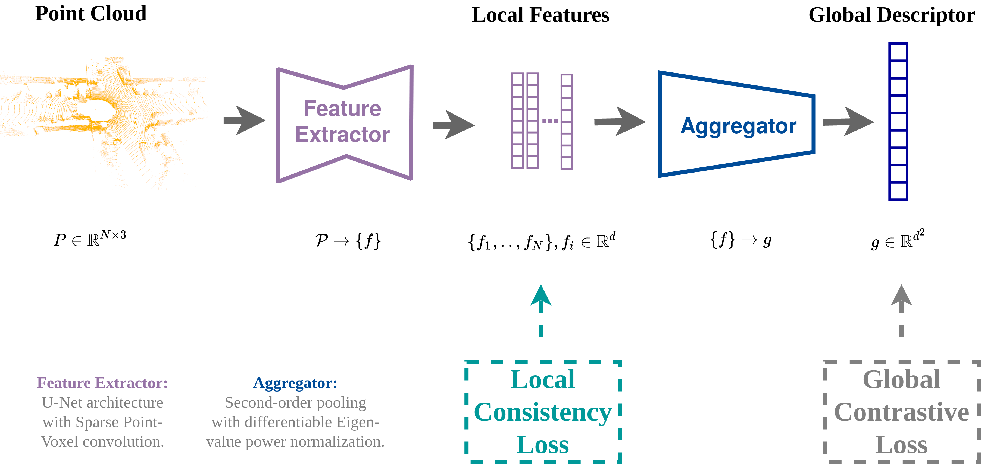
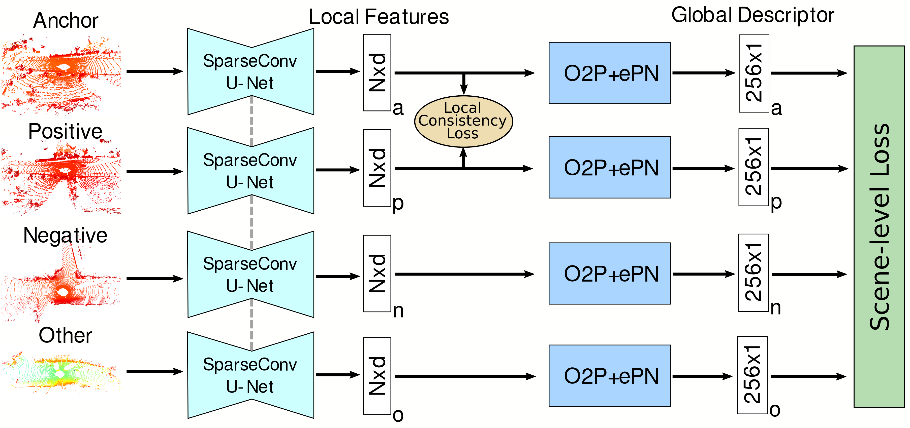

# LoGG3D-Net - M3GA-Wild Experiments

## M3GA-Wild Experiments
To run experiments on M3GA-Wild, first follow the installation instructions in [this section](#set-up-environment-m3ga-wild), but note that we ran LoGG3D-Net with different package versions to the original paper, as listed in `requirements.txt`. 

To train LoGG3D-Net on M3GA-Wild, we provide example training scripts in `example_scripts_m3gawild/low_altitude/train_logg3d_m3ga-wild_dim32.sh` for low altitude LiDAR, and `example_scripts_m3gawild/high_altitude/train_logg3d_m3ga-wild_airborne_dim32.sh` for high altitude LiDAR. By default, these scripts support a SLURM cluster with multi-gpu nodes for training via DDP, but for non-SLURM systems, you may alter the `_NGPU` value, and remove the `_HOSTS` env var if only using a single machine. To evaluate LoGG3D-Net on M3GA-Wild, we provide example evaluation scripts in `example_scripts_m3gawild/low_altitude/eval_*` and `example_scripts_m3gawild/high_altitude/eval_*`. The `eval_full_*` scripts will provide per-split evaluations with SpectralGV re-ranking (which is quite slow), whereas the `eval_*` scripts only return the mean over the entire dataset. Pre-trained weights can be downloaded from our HuggingFace page, or directly from [here](https://huggingface.co/EGriffiths-CSIRO/M3GA-Wild/resolve/main/LPR/low_altitude/logg3dnet_m3ga-wild.pth?download=true) for low altitude, and [here](https://huggingface.co/EGriffiths-CSIRO/M3GA-Wild/resolve/main/LPR/high_altitude/logg3dnet_m3ga-wild_airborne.pth?download=true) for high altitude. Once downloaded, they should be placed in the [checkpoints/](checkpoints/) directory.

## HOTFormerLoc/HOTFLoc++
See [this section](#hotflochotformerloc-experiments) for re-producing results from HOTFLoc++/HOTFormerLoc papers.

##

This repository is an open-source implementation of the ICRA 2022 paper: [LoGG3D-Net: Locally Guided Global Descriptor Learning for 3D Place Recognition](https://arxiv.org/abs/2109.08336) that won 2nd place at the [General Place Recognition: City-scale UGV 3D Localization Competition - Round 1](https://www.aicrowd.com/challenges/icra2022-general-place-recognition-city-scale-ugv-localization/leaderboards?challenge_round_id=1161). 

- Paper pre-print: https://arxiv.org/abs/2109.08336
- ICRA 2022 presentation: https://www.youtube.com/watch?v=HB6C6RHeYUU
 
We introduce a local consistency loss that can be used in an end-to-end global descriptor learning setting to enforce consistency of the local embeddings extracted from point clouds of the same location. We demonstrate how enforcing this property in the local features contributes towards better performance of the global descriptor in 3D place recognition. We formulate our approach in an end-to-end trainable architecture called *LoGG3D-Net*. 

## News
- [2023-05] Added new general dataloaders to help with training on custom datasets (such as [Wild-Places](https://github.com/csiro-robotics/Wild-Places)).
- [2023-03] LoGG3D-Net has been extended for 6-DoF metric localization in [SpectralGV](https://github.com/csiro-robotics/SpectralGV) RA-L 2023.
- [2023-03] Added support for PyTorch 2.0.
- [2022-05] Won 2nd place at the ICRA 2022 General Place Recognition Competition organized by AirLab, Carnegie Mellon University. Watch the invited talk [here](https://www.youtube.com/watch?v=xpEKOyJ7OIU&t=6503s). 
- [2022-05] Training code released.
- [2022-02] Evaluation code and pretrained models released.


## Method overview
- Joint constraints for local and global descriptors during training. 
- Inference on high-resolution point-clouds using Sparse Point-Voxel convolution to capture fine-grained detail. 
- Feature aggregation using higher-oder pooling to better capture the distribution of local features. 





## Usage

### Set up environment (M3GA-Wild)
#### Pixi
We provide a [pixi](https://pixi.prefix.dev/latest/installation/) environment to simplify environment setup.

Simply run this command out of this directory:
```bash
pixi install
pixi run <script_you_want_to_run>
```
Pixi handles all the dependencies and environment variable setup required to run LoGG3D-Net.

#### Original Setup Instructions (conda)
We alternatively provide a [requirements.txt](requirements.txt) with the package versions used in M3GA-Wild experiments. 
Below are the rough original instructions for setting up a conda environment to run LoGG3D-Net. We highly highly highly
recommend following the pixi route instead. If you follow the conda route though, ensure you manually `source env-setup.sh`
to correctly configure your PYTHONPATH in any new shell instance.

This project has been tested on a system with Ubuntu 22.04. Main dependencies include:
- [Pytorch](https://pytorch.org/) >= 1.13
- [TorchSparse](https://github.com/mit-han-lab/torchsparse) = 1.4.0
- [Open3d](https://github.com/isl-org/Open3D) >= 0.13.0

Set up the requirments as follows:
- Create [conda](https://docs.conda.io/en/latest/) environment with python:
```bash
conda create -n logg3d_env python=3.9.4
conda activate logg3d_env
```
- Install PyTorch with suitable cudatoolkit version. See [here](https://pytorch.org/):
```bash
pip3 install torch torchvision torchaudio
# Make sure the pytorch cuda version matches your output of 'nvcc --version'
```
- Install [Open3d](https://github.com/isl-org/Open3D), [Torchpack](https://github.com/zhijian-liu/torchpack):
```bash
pip install -r requirements.txt
```
- Install torchsparse-1.4.0
```bash
sudo apt-get install libsparsehash-dev
pip install --upgrade git+https://github.com/mit-han-lab/torchsparse.git@v1.4.0
```
- Install [mpi4py](https://mpi4py.readthedocs.io/en/stable/tutorial.html):
```bash
conda install mpi4py
conda install openmpi
```
**NOTE: BELOW STEPS NOT REQUIRED FOR HOTFLoc++/HOTFormerLoc/M3GA-Wild EXPERIMENTS**
- Download our pre-trained models from [DropBox](https://www.dropbox.com/scl/fi/ls0uyns1gv2q37frmy2p0/checkpoints.zip?rlkey=jt89tsxvgkghcww5v5xm3086x&dl=0) or [cloudstor](https://cloudstor.aarnet.edu.au/plus/s/G9z6VzR72TRm09S). Contains 7 checkpoints (6 for Kitti and 1 for MulRan) totalling 741.4 MB. Extract the content into ```./checkpoints/```:
```bash
wget -O checkpoints.zip https://cloudstor.aarnet.edu.au/plus/s/G9z6VzR72TRm09S/download
unzip checkpoints.zip
```
- Download the [KITTI odometry dataset](http://www.cvlibs.net/datasets/kitti/eval_odometry.php), the [MulRan dataset](https://sites.google.com/view/mulran-pr/dataset) and set the paths in ```config/eval_config.py```.
- For the KITTI odometry dataset, we are using the refined ground-truth poses provided in [SemanticKITTI](http://semantic-kitti.org/dataset.html#download).
- For the MulRan dataset, create ```scan_poses.csv``` files for each sequence using:
```bash
python ./utils/data_utils/mulran_save_scan_poses.py
```

### HOTFLoc++/HOTFormerLoc Experiments
Follow the below instructions to reproduce the LoGG3D-Net results reported in HOTFLoc++ and HOTFormerLoc:

1. Download LoGG3D-Net checkpoints from [HOTFLoc++ repo](https://github.com/csiro-robotics/HOTFLoc/tree/main?tab=readme-ov-file#pre-trained-weights-to-do-links), and place them in the `./checkpoints` directory. Ensure the checkpoints are renamed to match those in the checkpoint table. 
2. Symlink the `data` directory from HOTFLoc++ with `ln -s /path/to/HOTFLoc++/data ./data` (alternatively you can manually adjust the dataset paths in `config/eval_config.py`). 
3. Setup LoGG3D-Net environment as per the previous section. Before running any scripts, ensure you run `export PYTHONPATH=$PYTHONPATH:'</path/to/LoGG3D-Net>'; export OMP_NUM_THREADS=4` in your shell. We recommend at least 4 OMP threads to speed up RANSAC.
3. To reproduce CS-Wild-Places results, run the following:
```bash
source evaluation/sgv_evaluation/run_eval_logg3d_cswp_voxel0.8_parallel.sh
# If the above script causes you to run OOM, you can run the slower serial version:
source evaluation/sgv_evaluation/run_eval_logg3d_cswp_voxel0.8.sh
# Results are published to ./cs_wildplaces_sgv_results_metloc_success<_split>.txt
```
4. To reproduce Wild-Places results, run the following:
```bash
source evaluation/sgv_evaluation/run_eval_logg3d_wp.sh
# Results are published to ./wildplaces_sgv_results_metloc_success.txt
```
4. To reproduce MulRan results, run the following:
```bash
source evaluation/sgv_evaluation/run_eval_logg3d_mulran.sh
# Results are published to ./mulran_sgv_results_metloc_success.txt
```
By default, the metric loc results are reported for the 'success' protocol. To instead produce results for the 'all' protocol, use the '_metloc_all' variants of the above scripts.

### Training

Before training:
- Do offline mining of positive pairs for both datasets (at 3m and 20m):
```bash
python utils/data_utils/kitti_tuple_mining.py
python utils/data_utils/mulran_tuple_mining.py
``` 
- Set the number of GPUs available:
```bash
_NGPU=1
```

Training:
- eg. Default training parameters on Kitti:
```bash
torchpack dist-run -np ${_NGPU} python training/train.py \
    --train_pipeline 'LOGG3D' \
    --dataset 'KittiPointSparseTupleDataset'
```
- eg. Default training parameters on MulRan:
```bash
torchpack dist-run -np ${_NGPU} python training/train.py \
    --train_pipeline 'LOGG3D' \
    --dataset 'MulRanPointSparseTupleDataset'
```
- See ```config/train_config.py``` for all other training parameters.

### Evaluation
For KITTI (eg. sequence 06):
```bash
python evaluation/evaluate.py \
    --eval_dataset 'KittiDataset' \
    --kitti_eval_seq 6 \
    --checkpoint_name '/kitti_10cm_loo/2021-09-14_06-43-47_3n24h_Kitti_v10_q29_10s6_262450.pth' \
    --skip_time 30
```
For MulRan (eg. sequence DCC03):  
```bash
python evaluation/evaluate.py \
    --eval_dataset 'MulRanDataset' \
    --mulran_eval_seq 'DCC/DCC_03' \
    --checkpoint_name '/mulran_10cm/2021-09-14_08-59-00_3n24h_MulRan_v10_q29_4s_263039.pth' \
    --skip_time 90
```
<!-- 
Qualitative visualizations of top-1 retrievals on KITTI 08 and MulRan DCC 03:

  

  

Visualization of t-SNE embeddings of the local features extracted using our pre-trained model (on the [CMU AirLab ALITA dataset](https://github.com/MetaSLAM/ALITA)).

   -->

## Citation

If you find this work usefull in your research, please consider citing:

```
@inproceedings{vid2022logg3d,
  title={LoGG3D-Net: Locally Guided Global Descriptor Learning for 3D Place Recognition},
  author={Vidanapathirana, Kavisha and Ramezani, Milad and Moghadam, Peyman and Sridharan, Sridha and Fookes, Clinton},
  booktitle={2022 International Conference on Robotics and Automation (ICRA)},
  pages={2215--2221},
  year={2022}
}
```

## Acknowledgement
Functions from 3rd party have been acknowledged at the respective function definitions or readme files. This project was mainly inspired by the following: [FCGF](https://github.com/chrischoy/FCGF) and [SPVNAS](https://github.com/mit-han-lab/spvnas).

## Contact
For questions/feedback, 
 ```
 kavisha.vidanapathirana@data61.csiro.au
 ```
